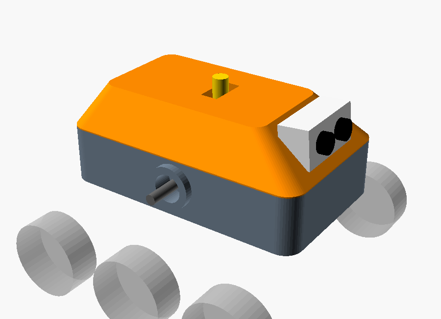
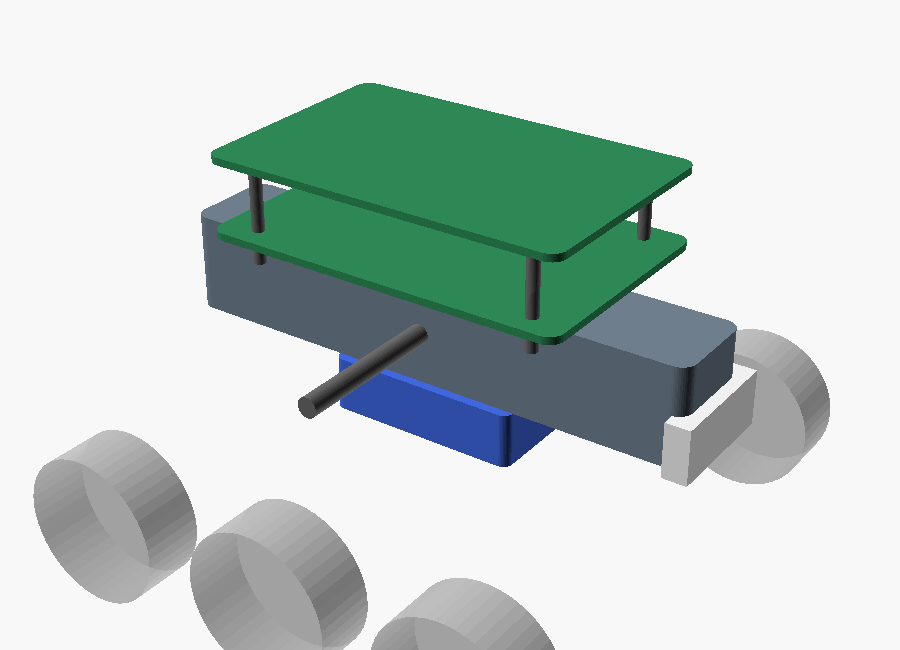
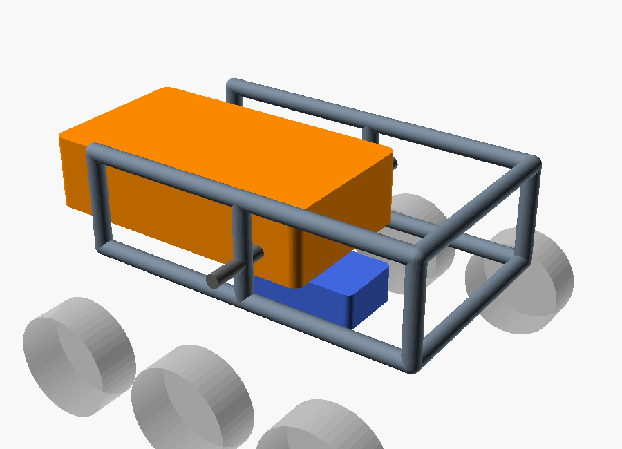
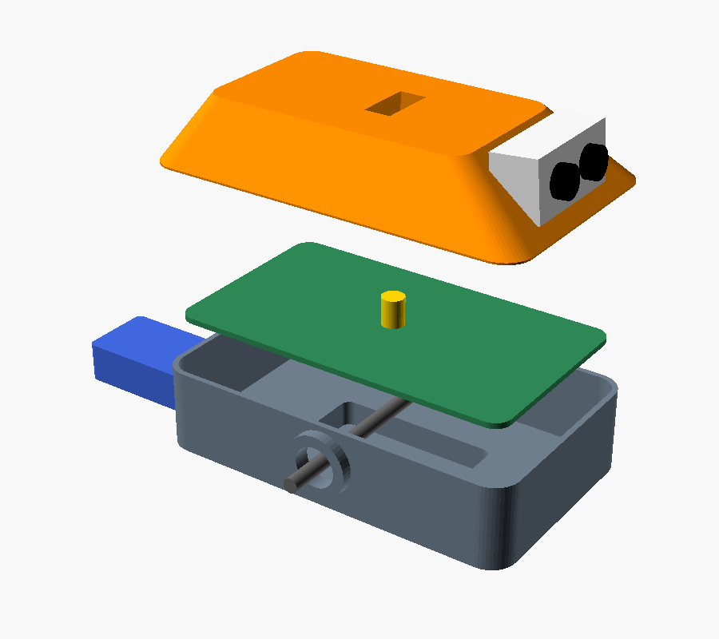
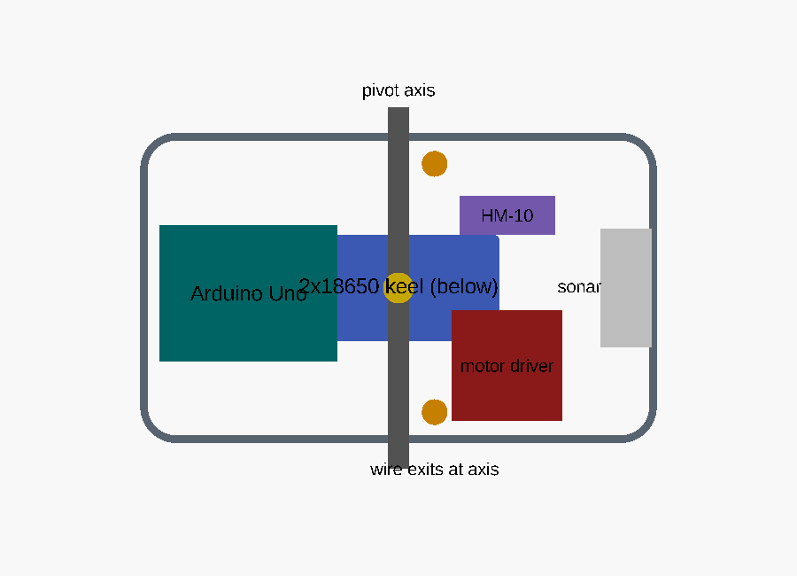
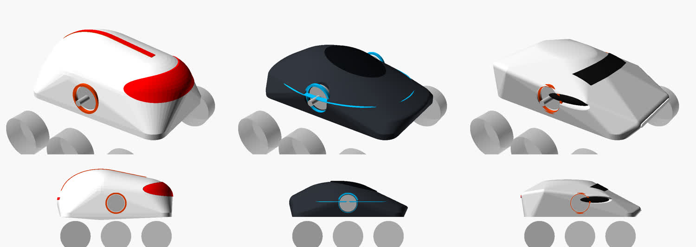
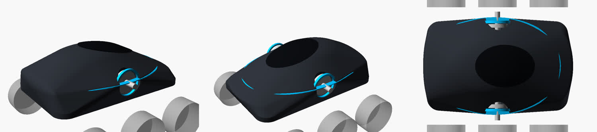

# 車體設計提案（設計階段）

> 範圍：只處理車體（chassis / body）。傳動系統（馬達、輪、懸吊連桿）尚未設計，本文件只定義車體要提供給它的**介面**。
> 圖檔由 `body-concepts.scad` 產生，是量體示意，不是可列印零件。

## 1. 上一版車體的問題

| 問題 | 後果 |
|------|------|
| 搖臂樞軸鎖在 4 mm 薄側板上，左右各一個獨立孔 | 受力全靠薄壁，容易變形；兩孔不同軸，懸吊會卡 |
| 電池放在頂板上 | 重心高，越障時容易翻 |
| 電子零件全部外露 | 碰撞、灰塵、線材勾到障礙物 |
| 沒有走線規劃 | 馬達線跨過活動關節，擺動時被拉扯 |
| 車身只是一塊 U 型板 | 沒有造型識別度，也沒有維修動線 |

## 2. 車體需求

1. **剛性樞軸**：左右懸吊共用一根貫穿車體的橫向軸，兩側軸承同軸。
2. **低重心**：最重的電池放在樞軸**下方**，讓車身像鐘擺一樣自然回正。
3. **保護電子零件**：上方有外殼，下方不外露。
4. **維修動線**：換電池不必拆電路；改電路不必拆懸吊。
5. **走線**：馬達線從**最靠近樞軸**的位置出車體，懸吊擺動時線長幾乎不變。
6. **可列印**：單件不超過 220 × 220 mm，盡量免支撐。
7. **內部空間**：Uno（69×53）、馬達驅動板（約 43×43×27）、2×18650 電池盒（約 77×41×20）、HM-10、HC-SR04。

## 3. 傳動系統介面（hardpoints，暫定）

| 介面 | 暫定規格 | 說明 |
|------|----------|------|
| 主樞軸 | Ø8 mm 鋼軸，608 軸承 ×2，軸心離地約 95 mm | 左右懸吊的轉軸 |
| 差速樞點 | 車頂中央垂直立柱 Ø12 mm | 若傳動採用差速桿，就接在這裡；不用就封起來 |
| 出線孔 | 樞軸前方 14 mm，左右各一 | 馬達線出入 |
| 前方感測器座 | 車頭 | 超音波（之後可換相機） |

這些數值等傳動設計時再一起定案。

## 4. 三個概念

### A — 甲殼（Carapace）⭐ 推薦

下方是一個**承力底盆**（tub），樞軸的軸承座直接長在底盆側壁的加厚凸台上；底盆下方凸出一個**龍骨電池槽**，電池從車尾抽出。上方蓋一個**多切面的外殼**，用磁鐵吸附、一拔就開；車頭是一個略微上仰的**感測器頭部**，超音波探頭當「眼睛」。

### B — 脊椎（Spine）

一根縱向**箱型樑**當骨幹，樞軸穿過樑中央；電子零件放在樑上方用銅柱疊起的兩層板，電池吊在樑下。

### C — 卡匣（Cassette）

外框是**管狀籠架**，專門承受懸吊受力；電子零件裝在一個**抽屜式卡匣**裡，從車尾整盒抽出；電池放在底部。

### 評比（3 = 最好）

| 準則 | A 甲殼 | B 脊椎 | C 卡匣 |
|------|:-----:|:-----:|:-----:|
| 樞軸剛性 | 3：軸承座在加厚盆壁上 | 3：樑本身就是軸座 | 2：管架接點多，列印接頭較弱 |
| 重心 | 3：電池在龍骨、低於樞軸 | 3：電池吊在樑下 | 2：卡匣整盒偏高 |
| 保護性 | 3：全包覆 | 1：電路完全外露 | 2：側面開放 |
| 維修 | 2：掀殼即可，但要拆托盤才看得到下層 | 3：全部看得到 | 3：整盒抽出 |
| 列印難度 | 2：底盆 200×120 單件、軸承孔要做淚滴形 | 3：零件小、平板為主 | 1：管架需拆件、接頭多 |
| 造型 / 識別度 | 3：有「臉」、有角色感 | 1：像開發板 | 2：工業風 |
| **合計** | **16** | **14** | **12** |

**為什麼選 A**：三個需求最重的項目——樞軸剛性、低重心、保護性——A 都拿滿分；它的缺點（底盆是大件、軸承孔需淚滴形）都屬於「多花點列印時間」，不是結構風險。B 若你最在意的是改電路方便，也是合理選擇，但它的電路完全外露，不適合越障時會碰撞的用途。

## 5. A 甲殼的細部設計

由下而上：

1. **龍骨電池槽**：2×18650 放在樞軸正下方，用滑軌式電池托盤從車尾抽出，尾端一顆 M3 螺絲固定。電池就是最重的配重，位置直接決定重心。
2. **承力底盆**（200×120×45，壁厚 3 mm，轉角 R14）：
   - 兩側軸承座是外凸 Ø34 mm 的圓台，內放 608 軸承；Ø8 鋼軸從整個車體貫穿，兩個座在同一次列印中成形，**天生同軸**。
   - 底盆開口朝上列印，免支撐；軸承孔做成淚滴形，避免橫向懸空。
3. **電子托盤**：一塊 3 mm 板，架在樞軸上方 6 mm，四角螺絲固定。主軸從托盤底下穿過，上下層分工：下層是軸與電池，上層是電路。
4. **甲殼外殼**：截頂角錐造型，四顆 6×3 mm 釹磁鐵吸附在底盆上緣。殼頂中央開槽，讓差速立柱穿出。
5. **感測器頭部**：上仰 5°，避免超音波打到地面造成誤判。頭部是獨立零件，日後換相機或加伺服轉頭時不必動外殼。

內部配置（俯視）：

- Uno 放後半部，USB 口朝車尾，掀殼就能插線。
- 馬達驅動板放前右，散熱片朝上，外殼前斜面開散熱縫。
- 出線孔在樞軸前方，靠近旋轉中心。

## 6. 流線造型（外殼）

需求更新：車體要**酷、漂亮、流線形**。結構核心（第 5 節的底盆、貫穿主軸、龍骨電池）不變，只重新設計外殼：

- 外殼**一路包到底盆下緣**，方盒底盆完全藏起來，整台車讀起來是一個完整形體。
- 主軸從殼面上的**圓形軸口**穿出，軸口加一圈色環當造型重點，也讓懸吊臂有活動空間。

圖檔由 `body-styling.scad` 產生（量體示意，不是可列印零件）。上排為立體圖，下排為側視圖：

| | 水滴艙 Pod | 魟魚 Manta ⭐ | 掠食者 Raptor |
|---|---|---|---|
| 形體 | 一整顆圓潤卵石，最高 | 寬、扁、低，側面一道水平稜線 | 楔形低車頭，後段肌肉感隆起 |
| 亮點 | 紅色包覆式護目鏡、背脊色條 | 透明座艙看得到內部電路、稜線藍色光條 | 側進氣口、車頭燈條、擋風玻璃 |
| 高度（殼頂離地） | 約 163 mm | 約 139 mm | 約 142 mm |
| 風格 | 可愛、科幻玩具 | 未來感、隱形機 | 跑車、攻擊性 |
| 列印 | 圓頂好印，但最高最佔體積 | 大面積平緩曲面，免支撐 | 稜面較多，表面最好處理 |

**推薦魟魚 Manta**：三款中最低、最扁、側面輪廓最連續，最符合「流線」；寬扁比例讓重心視覺上也壓得最低，跟龍骨電池的設計邏輯一致。

魟魚的細節構想：

- **座艙**：用透明或半透明 PETG 單獨列印，裡面的 Uno、驅動板燈號直接當內裝；座艙就是維修蓋，掀開即可改電路。
- **光條**：沿稜線留 4 mm 溝槽，嵌入 WS2812 燈條或用螢光線材列印。遙控 / 自動模式可以用不同顏色顯示。
- **感測器**：超音波探頭藏在車頭下緣的深色進氣口造型裡，不破壞輪廓。

已知限制（未驗證）：

- 三款外殼長度都約 229–238 mm，**超過 220 mm 列印平台**。做法有二：外殼沿主軸線前後拆成兩件（接縫剛好落在軸口色環上），或等你告知平台尺寸後等比例縮小。
- 外殼兩側緊貼懸吊活動區，懸吊行程與軸口大小要在傳動設計時一起確認。
- 渲染圖用的是預覽著色，顏色與實際列印線材不同。

## 7. 需要你決定的事

1. **造型**：照推薦用魟魚 Manta，還是水滴艙 / 掠食者？
2. **尺寸**：你的印表機平台多大？（決定外殼要拆兩件還是縮小）
3. **光條**：要加可程式 LED 燈條（需多一條訊號線、外接 5 V），還是只用線材配色？
4. **傳動方向**：上一版傳動系統哪裡不合理？這會影響第 3 節的介面數值與外殼軸口大小。

確認後的下一步：把選定造型做成可列印的底盆、托盤、外殼零件，再進入傳動設計。
