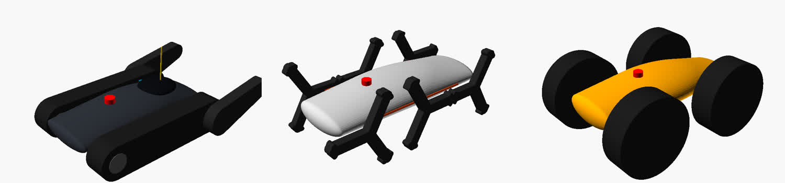
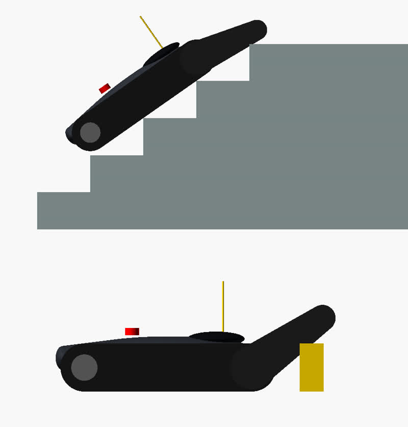

# 賽事版設計提案：國研院智慧機器人研究中心 戶外機器人障礙賽

> 依據：主辦單位簡報（2026/10/30 版）。簡報註明尺寸為設計階段數值，**正式規格於賽前 15 日（約 12/4）公布**。
> 圖檔由 `competition-concepts.scad` 產生，是量體示意，不是施工圖。

## 1. 賽事硬性條件

| 項目 | 內容 |
|------|------|
| 日期 | 報名 10/9–**11/27**；彩排 12/17；比賽 **12/19–20** |
| 組別 | 自主組 / 遙控組（遙控組可全程遙控） |
| 重量 | 含電池、載具、任務模組 ≤ 150 kg |
| 路線 | 單向連續約 250 m，串聯 7 關 |
| 審查 | 量測尺寸與重量、**實體急停硬體測試**、**遙控失聯保護實測** |
| 成績 | 不排名，以「關卡完成度」與「通關總時間」紀錄；可申請跳關 |

| # | 關卡 | 規格 | 對機器人的硬需求（推算） |
|---|------|------|--------------------------|
| 1 | 跨越障礙 | 5 / 10 / 15 / 20 cm 垂直，頂厚 10 cm | 能爬上 20 cm 直角邊 |
| 2 | 泥水坑 | 20 m × 2.4 m，邊框 10 cm | 低接地壓力、電子艙防水防泥 |
| 3 | 樓梯 + 平台 | 5 階、階高 20 cm、35° | 階深 28.6 cm，階緣間距 34.9 cm；接地長度 **≥ 70 cm** 才能同時跨 2 個階緣 |
| 4 | 下坡 | 20° | 停車時能自鎖、不溜車 |
| 5 | 固定障礙繞行 | 50 m 圓環上放三角錐 | 原地轉向、操控精度 |
| 6 | 交叉俯仰側傾 | 20 m × 2.4 m，坡面 15° | 低重心、四點以上著地 |
| 7 | 碎石堆 | 20 m × 2.4 m，最高 1 m | 鬆散地面牽引力、底盤不被卡住 |

推算（以整車 40 kg 為例）：樓梯 35° 爬坡力 225 N，乘 1.5 倍安全係數為 338 N；驅動輪半徑 8 cm 時，總扭力約 27 N·m（每側 13.5 N·m），0.4 m/s 時約需 135 W。

## 2. 對先前設計的影響

- **規模差了一個數量級**：先前的 Arduino + N20 小車（約 1 kg、60 mm 輪）無法通過任何一關的 20 cm 高差。先前的機構與韌體都不適用於比賽，只保留**魟魚造型語言**（低扁楔形、稜線光條、深色座艙）。
- **前後雙軸四輪**：可以參賽，但樓梯關風險最高：要爬 20 cm 階高，輪徑需約 45 cm 以上，而且四輪在 35° 階梯上只有兩個接觸點，容易打滑或卡在階緣上。所以列為備案，不推薦。

## 3. 三個概念

| 關卡 | ① 履帶＋前擺臂「魟魚戰車」 | ② 三叉輪腿 6×6 | ③ 雙軸大輪 4WD |
|------|:---:|:---:|:---:|
| 1 跨越 20 cm | ◎ 擺臂抬頭搭上去 | ◎ 輪腿直接跨 | ○ 輪徑 48 cm 勉強 |
| 2 泥水坑 | ◎ 接地壓力最低 | ○ 腳掌易陷 | ○ 需泥地胎 |
| 3 樓梯 35° | ◎ 80 cm 履帶跨 2–3 個階緣 | ○ 可爬但劇烈顛簸 | △ 高風險 |
| 4 下坡 20° | ◎ 長接地 + 馬達煞車 | ○ | ○ |
| 5 繞錐 | ○ 原地轉向但較慢 | ○ | ◎ 最快 |
| 6 俯仰側傾 | ◎ | ○ 晃動大 | ○ |
| 7 碎石堆 1 m | ◎ 履帶最適合 | ○ 可能卡石 | △ 底盤易被頂住 |
| 製作難度 / 時程 | 中（建議買現成履帶底盤） | 中（輪腿要自製） | 低 |
| 創意 / 造型 | 擺臂 + 魟魚外殼 | 最吸睛 | 普通 |

◎ 很適合　○ 可以　△ 有風險。以上是依機構原理的判斷，尚未實測。

## 4. 推薦：① 魟魚戰車（履帶 + 前擺臂）

履帶加擺臂是 NIST / ASTM 救災機器人測試（簡報各關的參考標準）中常見的配置。七關裡它有五關是最佳解，其餘兩關也沒有明顯短板。創意放在**擺臂玩法**和**魟魚外殼**上，不拿可靠度冒險。

### 規格（暫定，依實際採購件調整）

| 項目 | 規格 |
|------|------|
| 尺寸 | 長約 0.9 m（擺臂平伸約 1.25 m）、寬約 0.8 m、高約 0.35 m（不含天線） |
| 重量目標 | 35–45 kg |
| 履帶 | 橡膠履帶，接地長約 80 cm、寬 13 cm，帶抓地齒；**建議購買市售履帶底盤套件**（載重 ≥ 60 kg），省下 2–3 週 |
| 驅動 | 24 V 有刷減速馬達 ×2，每側驅動輪扭力 ≥ 15 N·m；建議選**附電磁煞車**的款式（例如電動輪椅馬達），下坡和樓梯停車不溜 |
| 前擺臂 | 左右擺臂同軸連動，渦輪蝸桿馬達 ≥ 80 N·m（推算需 59 N·m，再乘 1.3 倍），蝸桿可自鎖 |
| 電池 | 24 V 磷酸鐵鋰約 20 Ah（約 500 Wh），250 m 加上試跑綽綽有餘 |
| 馬達控制 | 雙通道 24 V、持續電流 ≥ 30 A，支援遙控器 PWM 輸入與訊號逾時停車 |
| 遙控 | 2.4 GHz 航模遙控器，接收機失控保護設為油門歸零；加裝 FPV 相機輔助 |
| 安全 | 車頂紅色**蘑菇頭急停**切斷主電源接觸器（審查必測）；失聯 → 驅動停止 + 煞車上鎖 |
| 防護 | 電子艙至少 IP54、線材用防水接頭；車頭楔形可撥開碎石 |
| 造型 | 魟魚低扁殼體夾在兩條履帶之間；稜線燈條兼作狀態燈（藍 = 正常、黃 = 低電量、紅 = 急停） |

### 關卡攻略與幾何驗證

- **跨越**：擺臂抬到約 35°，前進讓擺臂搭上障礙頂，再壓下擺臂抬起車頭，履帶就能把車拉上去（下圖）。
- **樓梯**：擺臂先勾住第一個階緣，車身上樓後擺臂收平；80 cm 履帶同時壓在 2–3 個階緣上（上圖）。重心只要低於接地面上方 50 cm 就不會後翻，本設計預估重心約 15–20 cm（未實測）。到頂部平台時把擺臂往前放下，避免車頭砸落。
- **下坡**：慢速下行，擺臂放下延長接地長度；停車時電磁煞車鎖死。
- **泥水坑 / 碎石堆**：正面直線進入，避免在坡上原地轉向；碎石堆頂端用擺臂撐住車頭，避免車頭下栽。
- **繞錐**：原地轉向；遙控組可用 FPV 畫面操作。
- **俯仰側傾**：側翻臨界角約 58°（輪距 64 cm、重心高 20 cm），15° 坡面有很大餘裕。

## 5. 時程（今天 11/4，距比賽 45 天）

| 期間 | 工作 |
|------|------|
| 11/4–11/10 | 確認設計；**立刻下單長交期件**：履帶底盤、馬達、電池、控制器 |
| 11/11–11/24 | 車架、擺臂機構、電子艙製作 |
| ≤ 11/27 | **完成報名** |
| 11/25–12/5 | 電控整合、首次行駛；12/4 前後官方公布正式規格，對照調整 |
| 12/6–12/15 | 自製簡易障礙實測：20 cm 台階、35° 樓梯、20° 坡、碎石 |
| 12/17 | 總彩排 |
| 12/19–20 | 比賽 |

最大時程風險是**零件交期**。如果履帶底盤兩週內到不了，備案是用 ③ 雙軸大輪先求完賽，樓梯關申請跳關。

## 6. 需要你決定的事

1. **組別**：建議**遙控組**。自主組要能自行導航 250 m 並辨識障礙，45 天內做到的風險很高。
2. **預算上限**？這決定履帶底盤和馬達是買現成還是自製。
3. **團隊加工能力**：能不能焊接、雷射切割或 CNC？有幾個人？
4. 方向是否採用 ① 魟魚戰車？確認後下一步做車架與擺臂的細部設計和採購清單。
